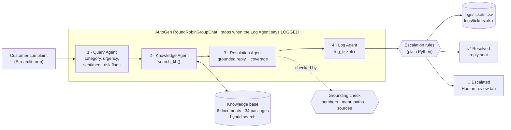

# BluePeak Support Desk: AI customer support with four AutoGen agents

A support desk for a growing online store. Four AI agents work as one team: they read each customer
complaint, look up the answer in the store's own policy documents, write a reply in the customer's
language, and hand risky or unclear cases to a person. Every ticket is recorded so the support team
can learn from it.

Built by **Selvakumar** for the Social Eagle AI Engineering Program (Multi-Agent Systems track).


---

## Contents
- [What it does](#what-it-does)
- [Results on the test complaints](#results-on-the-test-complaints)
- [Architecture](#architecture)
- [The four agents](#the-four-agents)
- [Escalation rules](#escalation-rules)
- [How the system avoids made-up answers](#how-the-system-avoids-made-up-answers)
- [Ticket log format](#ticket-log-format)
- [Setup and run](#setup-and-run)
- [Running the tests](#running-the-tests)
- [Screenshots](#screenshots)
- [Project structure](#project-structure)
- [Technology](#technology)
- [Problems solved while building](#problems-solved-while-building)
- [Bonus challenges](#bonus-challenges)

---

## What it does

| For the customer | For the support team |
|---|---|
| Gets an answer in about 6 to 12 seconds, in their own language (tested in English and Tamil) | Sees every agent's work live, step by step |
| The answer is based only on BluePeak Store's real policies | Risky cases arrive with a written reason: legal threat, fraud, angry customer, no matching policy… |
| Clear numbered steps, for example how to return shoes or reset a password | Approves or edits escalated replies in the **Human review** tab |
| | Filters and downloads the full ticket log (CSV / Excel) and watches trends on the **Dashboard** |

The knowledge base belongs to a made-up company, **BluePeak Store**, an Indian online store selling
footwear, clothing and home appliances. It has six documents with real-looking details (return
windows, delivery times, OTP rules, refund timelines) so every answer can be checked:
`shipping_policy.md`, `refund_policy.md`, `account_and_login.md`, `product_faq.md`,
`billing_and_payments.md`, `contact_and_escalation.md`.

---

## Results on the test complaints

All nine test complaints get the expected result through the full AutoGen team
(`python tests/try_team.py`). Cases 1 to 6 are from the assignment; 7 to 9 are our own.

| # | Complaint | Category | Policy found | Result | Escalation reason |
|---|---|---|---|---|---|
| 1 | Where is my order? It was supposed to arrive yesterday. | Shipping | shipping_policy.md | ✅ Resolved | |
| 2 | I want to return the shoes I bought last week. How do I get a refund? | Refund | refund_policy.md | ✅ Resolved | |
| 3 | I forgot my password and can't log in. | Account | account_and_login.md | ✅ Resolved | |
| 4 | The blender I received is broken. Can I get a replacement? | Product | product_faq.md | ✅ Resolved | |
| 5 | You charged my card three times! Fix this now or I'm contacting my bank and a lawyer. | Billing · High · Angry | billing_and_payments.md | 🚨 Escalated | High urgency; very angry customer; legal threat; payment dispute |
| 6 | Do you sell gift cards for a company of 500 employees with custom branding? | Other | none (NO_MATCH) | 🚨 Escalated | No matching document; low confidence |
| 7 | Someone hacked my account. There are two orders I never placed… | Account · High | account_and_login.md | 🚨 Escalated | High urgency; possible fraud; account security risk |
| 8 | என் ஆர்டர் இன்னும் வரவில்லை, 5 நாட்கள் ஆகிவிட்டது… (Tamil: "my order has not arrived for 5 days") | Shipping | shipping_policy.md | ✅ Resolved, **reply in Tamil** | |
| 9 | Hi, can I still change the delivery address? My order has not shipped yet. | Shipping · Low | shipping_policy.md | ✅ Resolved | |

Average processing time: about 6 seconds per ticket in the terminal test, about 12 seconds in the app.

---

## Architecture



**How one ticket flows**

1. The complaint (with optional customer name and order ID) becomes the first message of an
   AutoGen `RoundRobinGroupChat`, so the agents always speak in the order
   Query → Knowledge → Resolution → Log, and each one sees the conversation so far.
2. `team.run_stream()` hands every agent's output to the Streamlit app the moment it is produced,
   which is how the live timeline works.
3. The team stops cleanly when the Log Agent's tool answers `LOGGED TKT-0007 | status=…`
   (`TextMentionTermination("LOGGED")`), with `MaxMessageTermination(10)` as a safety net.
   A normal ticket uses 5 messages.
4. If anything fails mid-ticket (API error, an agent skipping its tool), a safety net in `team.py`
   still logs the ticket and escalates it with the error as the reason. No complaint is ever lost.

---

## The four agents

Every agent has a name, a one-line description and a focused system message. The two agents
that produce data return **structured output**: a Pydantic model that OpenAI must fill exactly,
so the next agent never receives vague or malformed text.

| Agent | Job | Input | Output |
|---|---|---|---|
| **Query Agent** (`agents/query_agent.py`) | Understands the complaint; never replies to the customer | Raw complaint | `QueryAnalysis`: category, urgency (Low/Medium/High), sentiment, one-line summary, risk flags, language, English search keywords |
| **Knowledge Agent** (`agents/knowledge_agent.py`) | Finds the policy passages that answer the problem | Analysis | Tool `search_kb(query)` → matching passages **with the source file name**, or `NO_MATCH` |
| **Resolution Agent** (`agents/resolution_agent.py`) | Writes a polite, customer-ready reply from those passages only | Complaint + analysis + passages | `ResolutionResult`: reply, coverage (full / partial / minimal / none), sources used, gaps |
| **Log Agent** (`agents/log_agent.py`) | Records the ticket and decides whether a person must take over | Everything above | Tool `log_ticket()` → one row in the log + `LOGGED` |

Design choices worth noting:

- **Knowledge Agent uses `reflect_on_tool_use=False`**, so its final message is the tool's raw
  output. The policy text reaches the Resolution Agent word for word; the LLM cannot summarise
  or change it on the way.
- **The Log Agent's tool reads what the agents really produced** (a `TicketContext`) instead of
  asking the LLM to copy the whole reply into the tool call, so the log always matches what happened.
- **Confidence is computed, not guessed.** LLMs are poor at picking exact numbers such as 0.87, so
  the Resolution Agent chooses a coverage label and Python turns it into a confidence:
  `0.7 × coverage score + 0.3 × search strength`, halved if the grounding check fails.

---

## Escalation rules

Escalation is a business rule, so it is plain Python (`agents/escalation.py`): the same ticket
always gets the same decision, and the rules are tested without any AI. A ticket is
**Escalated** if any of these is true, and every rule that fires is written into
`escalation_reason`:

| Rule | Source |
|---|---|
| Urgency is High | Assignment |
| The customer is very angry | Assignment |
| No matching policy document | Assignment |
| Legal threat, possible fraud or payment dispute | Assignment |
| Confidence below 0.5 | Assignment |
| Account security or safety risk | Added |
| The reply failed the grounding check | Added |
| The Log Agent raised a concern **and quoted the customer's words as evidence** | Added |

The Log Agent's own judgement is used for cases the rules would miss (for example "this is the third
time I am writing"). It must pick one of four concern types and quote the customer, and Python
checks that the quote really appears in the complaint. An invented concern is rejected.

---

## How the system avoids made-up answers

| Safeguard | What it prevents |
|---|---|
| Structured outputs (Pydantic) | Agents passing vague or malformed text to each other |
| Hybrid search with a **measured** `NO_MATCH` threshold | Answering questions the policies do not cover |
| Resolution Agent rules: only facts from the passages, no invented steps or menu paths | Invented policies |
| **Grounding check in Python**: every number, every menu path (e.g. `My Account > My Orders`) and every cited file in the reply must appear in the retrieved passages | Invented timelines, fees or website steps reaching a customer |
| A reply that fails the check is never sent: the customer gets a safe holding message and the ticket is escalated | A wrong answer going out |
| Human review of escalated tickets | Risky replies going out without a person's approval |

**How the threshold was chosen.** `tests/try_knowledge_agent.py` prints the best search score for
each test case. The weakest correct match (the broken blender) scored **0.41** and the strongest
wrong match (corporate gift cards) scored **0.25**, so the minimum score is set at the midpoint,
**0.33**, giving an equal safety margin on both sides.

---

## Ticket log format

One row per ticket in `logs/tickets.csv`, with an Excel copy in `logs/tickets.xlsx` (both created
automatically). All columns from the assignment, plus extras:

| Column | Example |
|---|---|
| `ticket_id` | TKT-0005 |
| `timestamp` | 2026-11-05 20:51:12 |
| `customer_name` / `order_id` | Rahul / ORD-4533 |
| `complaint` | You charged my card three times! Fix this now or I'm contacting my bank and a lawyer. |
| `category` / `urgency` / `sentiment` | Billing / High / Angry |
| `language` | English |
| `risk_flags` | legal_threat, payment_dispute |
| `kb_sources` / `kb_best_score` | billing_and_payments.md / 0.61 |
| `coverage` / `confidence` | full / 0.96 |
| `grounding` | OK |
| `response` | Dear Rahul, I sincerely apologise for the frustration… |
| `status` | Escalated |
| `escalation_reason` | High urgency; Very angry customer; Legal threat; Payment dispute |
| `processing_seconds` | 7.2 |
| `review_status` / `reviewed_reply` / `reviewer_note` / `reviewed_at` | Approved / … (filled by Human review) |

---

## Setup and run

Requirements: Python 3.10 or newer and an OpenAI API key.

```bash
git clone https://github.com/selvamca45/customer-support-agents.git
cd customer-support-agents

python3 -m venv venv
source venv/bin/activate          # Windows: venv\Scripts\activate
pip install -r requirements.txt

cp .env.example .env              # Windows: copy .env.example .env
# open .env and set OPENAI_API_KEY=sk-...
```

Run the app with one command:

```bash
streamlit run app.py
```

Then open **http://127.0.0.1:8502** (the address and port are set in `.streamlit/config.toml`).

Or try the team from the terminal:

```bash
python team.py "The blender I received is broken. Can I get a replacement?"
```

The API key lives only in `.env`, which is listed in `.gitignore`; `.env.example` holds a
placeholder. The model can be changed with `OPENAI_MODEL` in `.env` (default `gpt-4o-mini`).

---

## Running the tests

Each step of the pipeline has its own test script, all using the same nine complaints in
`tests/test_cases.py`:

| Command | What it checks |
|---|---|
| `python tests/try_query_agent.py` | Category, urgency, sentiment and language for all cases |
| `python tests/try_knowledge_agent.py` | The right policy file is found; prints the threshold check |
| `python tests/try_resolution_agent.py` | Every reply, its confidence and the grounding check |
| `python tests/try_log_agent.py` | Escalation rules and evidence checks without AI, then all four agents |
| `python tests/try_team.py` | **End to end** through the AutoGen team: 9/9 expected statuses |

---

## Screenshots

| | |
|---|---|
| **Resolved ticket**, with the live agent timeline<br> | **Escalated ticket**, with its reasons<br> |
| **Reply in Tamil** (own test case)<br> | **Hacked account** (own test case)<br> |
| **Ticket log** with filters and downloads<br> | **Dashboard**<br> |
| **Human review** of an escalated reply<br> | **About & how it works**<br> |

---

## Project structure

```
customer-support-agents/
├── app.py                   Streamlit interface
├── team.py                  the four agents as one AutoGen team (+ terminal demo)
├── config.py                settings, .env loading, OpenAI model client
├── agents/
│   ├── query_agent.py       Agent 1 + QueryAnalysis model
│   ├── knowledge_agent.py   Agent 2 + search_kb tool
│   ├── kb_search.py         chunking, embeddings, hybrid search, NO_MATCH threshold
│   ├── resolution_agent.py  Agent 3 + grounding check + confidence
│   ├── log_agent.py         Agent 4 + log_ticket tool + evidence-checked concerns
│   ├── escalation.py        escalation rules
│   └── ticket_logger.py     CSV / Excel log and human review updates
├── ui/
│   ├── theme.py             colours, fonts, header and footer
│   └── about.py             the About & how it works tab
├── knowledge_base/          6 BluePeak Store policy documents
├── tests/                   test cases and one test script per step
├── logs/                    tickets.csv, tickets.xlsx (created automatically)
├── screenshots/             images used in this README
├── .streamlit/config.toml   theme, address and port
├── .env.example             OPENAI_API_KEY=your-key-here
├── requirements.txt
└── README.md
```

---

## Technology

| Layer | Tool | Used for |
|---|---|---|
| Agents | AutoGen AgentChat 0.7 | `AssistantAgent`, `RoundRobinGroupChat`, `TextMentionTermination`, `MaxMessageTermination`, tools, structured output |
| Language model | OpenAI `gpt-4o-mini` | Understanding complaints and writing replies |
| Search | OpenAI `text-embedding-3-small` + keyword scoring | Hybrid search (80 % meaning, 20 % exact words), vectors cached in `kb_index/` |
| Validation | Pydantic | Every agent output |
| Logging | pandas, openpyxl | CSV and Excel ticket log |
| Interface | Streamlit, Altair | App, live timeline, dashboard |

---

## Problems solved while building

1. **Structured outputs crashed the team.** Agents with `output_content_type` worked alone but the
   team rejected their `StructuredMessage[...]` messages. Fixed by registering them with
   `custom_message_types` on the `RoundRobinGroupChat`.
2. **The AI invented website steps.** When a policy did not say *how* to change an address, the
   reply made up "Order History > Edit Address". Fixed with a Python check that rejects any menu path
   not found in the retrieved passages, and by adding the real steps to the policy.
3. **The Log Agent invented escalation reasons** ("repeated complaint" when the customer never said
   so). Fixed by requiring a fixed concern type plus a quote from the customer, verified in Python.
4. **Confidence was stuck at 0.60** for perfect answers. Fixed by letting the LLM choose a coverage
   label and computing the number in Python.
5. **The no-match threshold was a guess.** Replaced by a measured value (0.33) halfway between the
   weakest correct match and the strongest wrong match.

---

## Bonus challenges

| Bonus | Status |
|---|---|
| Embeddings + vector search | ✅ OpenAI embeddings with hybrid scoring |
| Dashboard: tickets per category, resolved vs escalated, average urgency | ✅ |
| Reply in the customer's language | ✅ (Tamil tested) |
| Human approval of escalated replies | ✅ Human review tab |

---

Built by **Selvakumar** · Social Eagle AI Engineering Program
